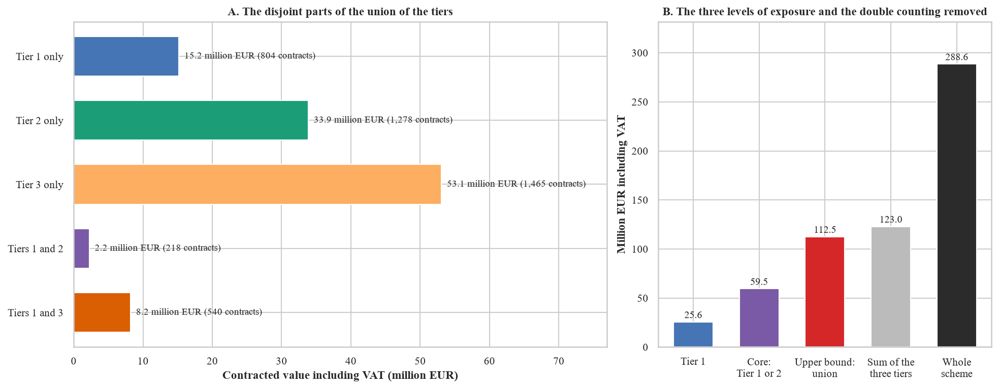
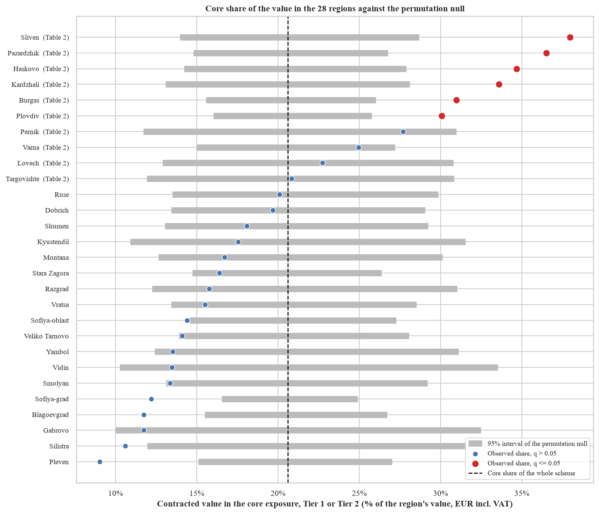
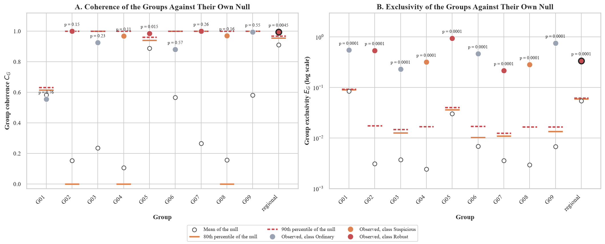
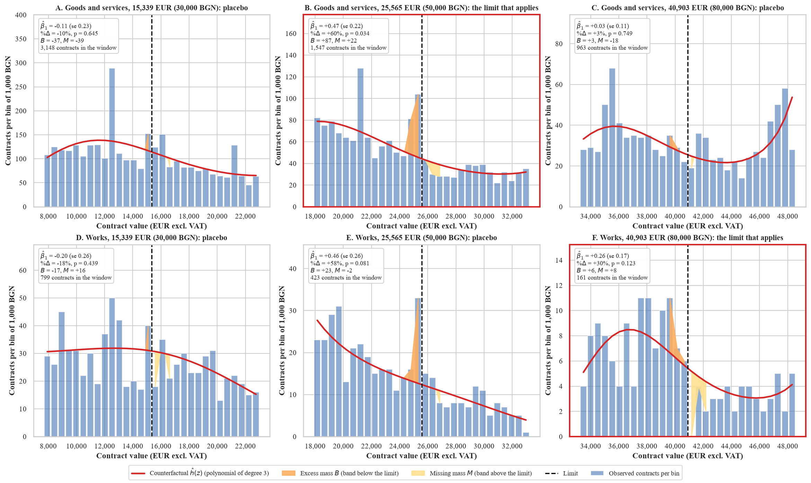

# Fiscal Exposure and Integrity Risk in School Public Procurement

*Forensic econometric and network analysis of the Bulgarian School STEM Programme (BG-RRP-1.015) under the National Recovery and Resilience Plan.*

Under procedure BG-RRP-1.015 "School STEM Environment", 2,222 schools signed 11,128 contracts worth 288.57 million EUR including VAT with 1,754 suppliers. The study screens the whole programme for two risks that the literature links to decentralised buying under direct-award limits: values placed just below the limits and a market shared among a few coordinated suppliers. It validates the indicators against 560 inspection reports of the State Financial Inspection Agency (ADFI). The study is one Jupyter notebook in English, `Fiscal_Exposure_Integrity_Risk_School_STEM_Procurement.ipynb`. It contains the mathematics, the algorithms implemented from scratch, ten robustness experiments and the data they use.

**A statistical indicator is not evidence of a violation.** No school, supplier, municipality or person is accused of anything, and the repository contains no personal data.

## Main results

| Question | Result |
|---|---|
| Do the largest suppliers form a group? | No. Their overlap is explained by their size: under the bipartite configuration model, 1 of 621 and 0 of 316 links remain. |
| Are there groups that size does not explain? | Yes, a few. The clearest is a regional group of two consultants and a supplier of furnishing. They share 103 schools, against a simulated 9.6 to 23.4 per pair in 10,000 degree-preserving networks, and the consultant signs first in 103 of 108 schools. |
| Do local authorities matter? | Municipal schools follow the leading supplier of their municipality more than state schools of the same region (gap +0.090, permutation p = 0.001). |
| Are values placed below the limits? | Suggestively. For goods and services the density below 50,000 BGN is 59.9% above a smooth counterfactual (q = 0.067), significant in 8 of 14 specifications. |
| Do the audits agree? | At the level of the supplier named in a report, yes: a supplier with a flagged contract is cited in a violation finding 1.6 times more often than the other suppliers of the school (odds ratio 1.7 to 2.3 with contract size held fixed). At the level of the school, hardly: 83.3% of audited schools receive an act. |
| How much money? | Core exposure 59.46 million EUR (20.6% of the programme), within a range from 25.60 million EUR (8.9%) for contract-level flags to an upper bound of 112.53 million EUR (39.0%). An exposure is spending to be examined, not a loss. |
| Where? | The core exposure exceeds a random allocation in six regions (Sliven, Pazardzhik, Haskovo, Kardzhali, Burgas, Plovdiv) and in 14 of 193 municipalities. |

<p align="center">
  <br>
  <em><strong>Figure 13.</strong> Disjoint parts of the union of the three tiers (panel A) and the three levels of the fiscal exposure against the sum of the tiers and the whole programme (panel B), EUR including VAT.</em>
</p>

<p align="center">
  <br>
  <em><strong>Figure 12.</strong> Share of the contracted value in the core exposure (Tier 1 or Tier 2) across the 28 regions against the 95% interval of the permutation null.</em>
</p>

<p align="center">
  <br>
  <em><strong>Figure 7.</strong> Coherence C<sub>G</sub> (panel A) and exclusivity E<sub>G</sub> (panel B) of the nine Louvain groups and the regional group against their degree-preserving null.</em>
</p>

<p align="center">
  <br>
  <em><strong>Figure 9.</strong> Contract values under Regime 2 around the statutory limits of 30,000, 50,000 and 80,000 BGN excluding VAT for goods/services and works.</em>
</p>

## Structure of the notebook

| Part | Content |
|---|---|
| Abstract, contents, introduction | Significance, aim, tasks, method and main results |
| 1 | Computing environment: imports, paths, configuration, version check (CPU only) |
| 2–3 | Legal limits of direct award before and from 1 January 2024, hypotheses, methods, glossary of the statistics for economists |
| 4 | Data: ISUN 2020 contracts, register of schools, ADFI reports, reconciliation of the sample |
| 5 | Market structure and validated supplier groups (H1, H2): SVN, BiCM with an exact Poisson-binomial tail, 10,000-network Monte Carlo null, communities |
| 6 | Municipal and regional concentration (H3) |
| 7 | Contract values and dates (H4a, H4b): bunching, Benford, same-day splitting, contracts signed before the project start |
| 8 | Validation against the audits, rankings of municipalities, regions and suppliers, fiscal exposure (H4c, H4d) |
| 9–10 | Robustness (Experiments 1–10), conclusions, limitations, recommendations |
| Appendices | A: verification of the methods on synthetic data; B: data protection audit of all tables |

## Replication

Requirements: Python 3.13 and the packages of `requirements.txt`. The computation is CPU-only. No GPU, CUDA or deep-learning library is used, and the notebook asserts that none is loaded.

```bash
python -m pip install -r requirements.txt
```

```bash
jupyter nbconvert --to notebook --execute --inplace Fiscal_Exposure_Integrity_Risk_School_STEM_Procurement.ipynb
```

- The seed is fixed (`SEED = 42`) and every permutation repeats exactly.
- A full run takes about 7 minutes and about 2.6 GiB of memory on a laptop. The Monte Carlo ensemble of 10,000 networks takes most of both.
- The run rewrites the tables of `data/derived/` and the figures of `img/`.
- `data/raw/` (copies of the sources) and `data/cache/` (large arrays) are not in the repository. Without them the notebook reads the working tables of `data/` and recomputes the cache.

## Repository

```
Fiscal_Exposure_Integrity_Risk_School_STEM_Procurement.ipynb   the study, executed
requirements.txt                                               minimum versions of the packages
data/                                                          working tables built from the public sources (no personal data)
data/derived/                                                  results: contract table, validated links and groups, flags, Tables 1-4
img/                                                           figures of the study, written by the notebook
SELF_ASSESSMENT.md                                             self-assessment against the six criteria of the guidelines
LICENSE
```

## Sources

- ISUN 2020 open data: https://2020.eufunds.bg/bg/0/0/OpenData
- ADFI inspection reports: https://www.adfi.minfin.bg/bg/34
- Register of schools of the Ministry of Education and Science

The literature, the laws and the regulations are listed with full references at the end of the notebook.

## Disclaimer

The indicators are diagnostic signals computed from public records. They do not establish illegality, collusion or a violation by any school, supplier, municipality or official, and a flagged contract is not a finding of an audit body.
